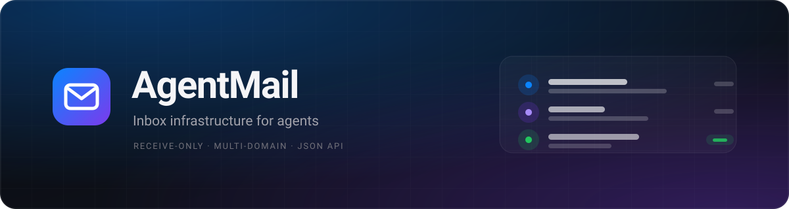
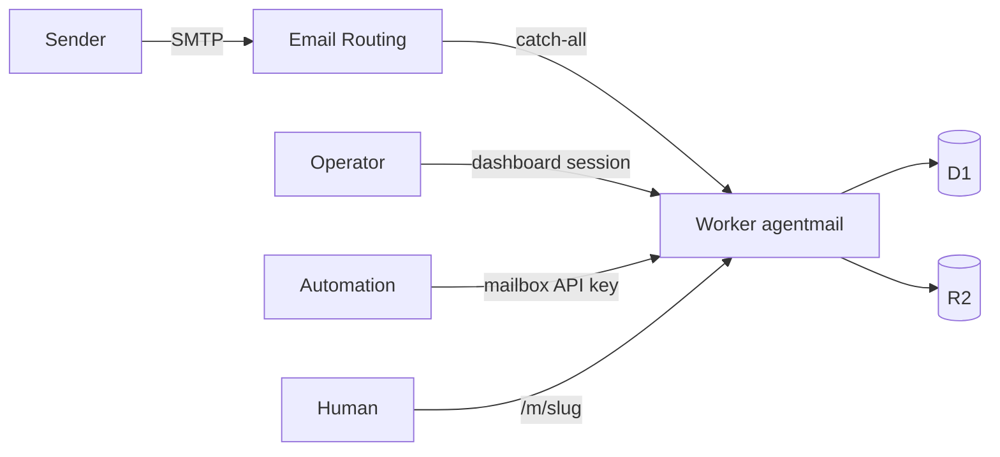

<p align="center">
  
</p>

<p align="center">
  <a href="https://github.com/hirotomasato/agenmail/actions/workflows/ci.yml"></a>
  <a href="LICENSE"></a>
  = 20.3" />
</p>

Inbox infrastructure for agents, on your own domains. One Cloudflare Worker receives mail
through Email Routing, stores it in D1 + R2, and exposes it as structured JSON. A private
dashboard provisions mailboxes, and every mailbox has a short link for humans.

- Receive-only. No SMTP server to run.
- Multi-domain. One Worker serves every zone in the account.
- Operator provisioning. Public creation is disabled by default.
- Two credentials per mailbox: an API key for automation, a 7-character link for people.
- Parsed JSON: text, HTML, headers, SPF/DKIM/DMARC, OTP codes, intent, action links.
- iOS-style UI with dark mode, swipe actions and live updates.

## Contents

- [Requirements](#requirements)
- [Install locally](#install-locally)
- [Deploy to production](#deploy-to-production)
- [Configuration](#configuration)
- [Connect domains](#connect-domains)
- [API](#api)
- [Dashboard](#dashboard)
- [Storage layout](#storage-layout)
- [Scripts](#scripts)
- [Troubleshooting](#troubleshooting)
- [Security notes](#security-notes)
- [Project structure](#project-structure)
- [Contributing](#contributing)
- [License](#license)



## Requirements

- Cloudflare account with the zones you want to receive mail on
- Node.js >= 20.3 (wrangler is pinned to 4.80 for Node 20)
- pnpm

## Install locally

```bash
pnpm install

cp .dev.vars.example .dev.vars
# edit .dev.vars: TOKEN_PEPPER and ADMIN_TOKEN, any long random strings

pnpm db:migrate     # create tables in the local D1 (.wrangler/state)
pnpm build          # build the UI into dist/web
pnpm dev:api        # Worker + assets on http://127.0.0.1:8787
```

Open `http://127.0.0.1:8787/login` and sign in with the dev `ADMIN_TOKEN`.

Optional helpers:

```bash
pnpm dev:web                  # Vite HMR on :5173, proxies /api to :8787
node scripts/seed-demo.mjs    # create a demo mailbox with four messages
pnpm smoke                    # create, deliver, read against a running dev server
node scripts/audit-api.mjs    # print live response shapes for every endpoint
```

### Test inbound mail locally

`wrangler dev` exposes an email handler endpoint, so you can inject a real MIME message:

```bash
# 1. register a local domain
curl -X POST "http://127.0.0.1:8787/api/v1/admin/domains" \
  -H "Authorization: Bearer dev-admin-token" \
  -H "Content-Type: application/json" -d '{"domain":"mail.test"}'

# 2. create the mailbox that scripts/sample.eml targets
curl -X POST "http://127.0.0.1:8787/api/v1/mailboxes" \
  -H "Authorization: Bearer dev-admin-token" \
  -H "Content-Type: application/json" -d '{"domain":"mail.test","local":"demo"}'

# 3. deliver it
curl -X POST "http://127.0.0.1:8787/cdn-cgi/handler/email?from=noreply@example.com&to=demo@mail.test" \
  --data-binary @scripts/sample.eml
```

The message appears in the dashboard and at its `/m/<slug>` link.

## Deploy to production

### 1. Create storage

```bash
npx wrangler d1 create agentmail
npx wrangler r2 bucket create agentmail-mail
```

Copy the printed D1 `database_id` into `wrangler.jsonc`.

### 2. Configure `wrangler.jsonc`

```jsonc
{
  "routes": [{ "pattern": "app.example.com", "custom_domain": true }],
  "d1_databases": [{
    "binding": "DB",
    "database_name": "agentmail",
    "database_id": "<your-d1-id>",
    "migrations_dir": "migrations"
  }],
  "r2_buckets": [{ "binding": "MAIL", "bucket_name": "agentmail-mail" }],
  "vars": {
    "PUBLIC_BASE_URL": "https://app.example.com",
    "PUBLIC_CREATE_ENABLED": "false"
  }
}
```

`PUBLIC_BASE_URL` makes access links use your hostname. Without it, links use whatever
origin the request arrived on.

### 3. Set secrets

```bash
npx wrangler secret put TOKEN_PEPPER   # openssl rand -hex 32
npx wrangler secret put ADMIN_TOKEN    # or a prefixed token like agn_xxxxxxxxxxxxxxxxxxxx
```

Keep both somewhere safe. `TOKEN_PEPPER` hashes mailbox API keys and signs dashboard
sessions; changing it later invalidates every existing API key and session.

### 4. Apply the schema and deploy

```bash
npx wrangler d1 migrations apply DB --remote
pnpm deploy            # builds the UI, then wrangler deploy
```

The deploy prints the Worker URL and the custom domain. If you are not using a custom
domain, remove `routes` and the Worker gets a `*.workers.dev` hostname.

### 5. Sign in and connect a domain

1. Open `https://app.example.com/login` with the admin token.
2. Cloudflare dashboard, per zone: **Email** > **Email Routing** > **Enable Email Routing**.
3. **Routing rules** > **Catch-all address** > **Send to a Worker** > `agentmail`.
4. In AgentMail: **Domains** > **Add** `example.com`.

Mail to an unregistered or inactive domain is dropped at ingest, not bounced.

## Configuration

| Name | Type | Default | Purpose |
| --- | --- | --- | --- |
| `TOKEN_PEPPER` | secret | none | hashes API keys, signs admin sessions |
| `ADMIN_TOKEN` | secret | none | operator login and admin API bearer token |
| `PUBLIC_BASE_URL` | var | empty | absolute origin used in `accessUrl` |
| `PUBLIC_CREATE_ENABLED` | var | `false` | `true` allows anonymous `POST /mailboxes` |
| `CREATE_LIMIT_PER_HOUR` | var | `20` | per-IP limit when public creation is on |
| `DEFAULT_DOMAIN` | var | empty | domain used when a create request omits one |
| `DB` | D1 binding | | metadata, messages, attachments, counters |
| `MAIL` | R2 binding | | raw MIME, HTML part, attachments |
| `ASSETS` | assets binding | | built UI from `dist/web` |

Cron trigger `17 * * * *` purges expired mailboxes and old rate-limit rows.

## Connect domains

A domain needs two things: Email Routing pointed at `agentmail`, and a row in the
`domains` table.

1. **Enable Email Routing** for the zone. Cloudflare adds `route1/2/3.mx.cloudflare.net`
   and an SPF include. If the zone already has an SPF record, merge the include instead
   of adding a second one.
2. Set the **catch-all** rule to **Send to a Worker** > `agentmail`.
3. Register the domain in the dashboard or with the API:

```bash
curl -X POST "https://app.example.com/api/v1/admin/domains" \
  -H "Authorization: Bearer $ADMIN_TOKEN" \
  -H "Content-Type: application/json" \
  -d '{"domain":"example.com"}'
```

Verify DNS:

```bash
nslookup -type=mx example.com 1.1.1.1
```

If the apex already receives mail through Google Workspace or Microsoft 365, do not
enable Email Routing on the apex. Use a subdomain zone such as `mail.example.com`
instead. The Worker stays the same.

## API

Base path `/api/v1`. Responses are JSON except raw MIME and attachment downloads.
`:id` also accepts `me`, meaning the mailbox behind the credential.

### Authentication

| Header | Scope |
| --- | --- |
| `Authorization: Bearer $ADMIN_TOKEN` | create mailboxes, admin routes, domains, stats |
| `Cookie: agentmail_admin=...` | dashboard session, same admin powers, mutations need `X-AgentMail-CSRF: 1` |
| `X-API-Key: am_live_...` | one mailbox: read, delete, extend TTL, rotate link |
| `X-Access-Token: <slug>` | one mailbox via its link: read, delete, extend, no mailbox deletion |

Anonymous `POST /mailboxes` returns `403 creation_disabled` while
`PUBLIC_CREATE_ENABLED=false`.

### Create a mailbox

```bash
curl -X POST "https://app.example.com/api/v1/mailboxes" \
  -H "Authorization: Bearer $ADMIN_TOKEN" \
  -H "Content-Type: application/json" \
  -d '{"domain":"random"}'
```

Body fields, all optional:

| Field | Notes |
| --- | --- |
| `domain` | concrete domain, `random` (also `any`, `auto`, `*`), or omit for the default |
| `local` | exact local part; omit for a generated human-looking name |
| `label` | free-form, max 80 chars |
| `ttl` | seconds from now, 60 to 2592000; omit for no expiry |
| `meta` | JSON object, max 4 KiB |

Response `201`:

```json
{
  "object": "mailbox",
  "id": "mb_01JB...",
  "address": "rina.nugroho@example.com",
  "local": "rina.nugroho",
  "domain": "example.com",
  "status": "active",
  "createdAt": "2026-11-04T09:12:00.000Z",
  "expiresAt": null,
  "messageCount": 0,
  "unreadCount": 0,
  "accessUrl": "https://app.example.com/m/x7Kp2Qa",
  "apiKey": "am_live_...",
  "apiKeyPrefix": "am_live_9fK2",
  "accessToken": "x7Kp2Qa"
}
```

`apiKey` is returned once. `local` is unique per domain; a duplicate returns
`409 address_taken`. Generated names are retried on collision.

### Read the inbox

```bash
# long-poll for up to 25 seconds, returns as soon as a message arrives
curl -s "https://app.example.com/api/v1/mailboxes/me/messages?wait=25" \
  -H "X-API-Key: $API_KEY"

# full parsed message
curl -s "https://app.example.com/api/v1/messages/<messageId>" \
  -H "X-API-Key: $API_KEY"
```

List parameters: `limit` (1-100), `cursor`, `since` (ms or ISO), `unread=1`, `wait`
(0-25). Long-poll returns the newest messages first.

Message envelope:

```json
{
  "object": "message",
  "v": 1,
  "id": "01M6H9RZ...",
  "mailboxId": "mb_01JB...",
  "from": { "name": "GitHub", "address": "noreply@github.com" },
  "to": [{ "name": null, "address": "rina.nugroho@example.com" }],
  "cc": [],
  "subject": "Your verification code",
  "snippet": "Your verification code is 483920...",
  "receivedAt": "2026-11-04T09:13:02.000Z",
  "size": 8123,
  "hasAttachments": false,
  "attachmentCount": 0,
  "seen": false,
  "text": "...",
  "html": "...",
  "headers": { "authentication-results": "..." },
  "authentication": { "spf": "pass", "dkim": "pass", "dmarc": "pass" },
  "extracted": {
    "otp": ["483920"],
    "links": ["https://github.com/settings/sessions"],
    "codes": ["SAVE20"],
    "intent": "verification",
    "primaryLink": "https://github.com/settings/sessions",
    "actionText": "Review your sessions",
    "unsubscribe": ["https://github.com/unsubscribe"]
  },
  "attachments": [],
  "urls": { "self": "/api/v1/messages/...", "raw": "/api/v1/messages/.../raw" }
}
```

`intent` is one of `verification`, `password_reset`, `receipt`, `newsletter`,
`notification`, `other`. `primaryLink` is the link that matches the intent and
`unsubscribe` is kept separate so automation never follows it. HTML is returned as sent;
the UI sanitizes it before rendering.

### Endpoints

| Method | Path | Notes |
| --- | --- | --- |
| `GET` | `/api/v1/health` | liveness |
| `GET` | `/api/v1/domains` | active domains |
| `POST` | `/api/v1/mailboxes` | admin token or dashboard session |
| `GET` | `/api/v1/mailboxes/:id` | counts, expiry, accessUrl |
| `PATCH` | `/api/v1/mailboxes/:id` | `{"label":..., "ttl":...}` |
| `DELETE` | `/api/v1/mailboxes/:id` | API key only |
| `POST` | `/api/v1/mailboxes/:id/rotate-token` | new share link |
| `GET` | `/api/v1/mailboxes/:id/messages` | list, cursor, since, unread, wait |
| `GET` | `/api/v1/messages/:id` | full JSON |
| `GET` | `/api/v1/messages/:id/raw` | original RFC 822 |
| `GET` | `/api/v1/messages/:id/attachments/:attachmentId` | blob |
| `POST` | `/api/v1/messages/:id/seen` | mark read |
| `DELETE` | `/api/v1/messages/:id` | message and blobs |
| `POST` | `/api/v1/admin/session` | exchange admin token for a 7-day cookie |
| `GET` | `/api/v1/admin/session` | session check |
| `DELETE` | `/api/v1/admin/session` | clear cookie |
| `GET` | `/api/v1/admin/mailboxes` | `q`, `domain`, `limit` |
| `PATCH` | `/api/v1/admin/mailboxes/:id` | `label`, `ttl`, `status` |
| `DELETE` | `/api/v1/admin/mailboxes/:id` | mailbox and blobs |
| `POST` | `/api/v1/admin/mailboxes/:id/rotate-token` | new share link |
| `POST` | `/api/v1/admin/mailboxes/:id/rotate-key` | revoke API key, return new one |
| `POST` | `/api/v1/admin/messages/:id/reparse` | re-run parsing on stored raw MIME |
| `GET/POST` | `/api/v1/admin/domains` | list or register |
| `PATCH/DELETE` | `/api/v1/admin/domains/:domain` | label, active, remove |
| `GET` | `/api/v1/admin/stats` | totals and per-domain |

Errors use one envelope:

```json
{ "error": { "code": "mailbox_expired", "message": "This mailbox has expired", "requestId": "..." } }
```

Common codes: `401 invalid_api_key`, `403 creation_disabled`, `403 insufficient_scope`,
`403 csrf_failed`, `404 message_not_found`, `409 address_taken`, `410 mailbox_expired`,
`429 rate_limited`, `429 too_many_attempts`, `503 no_domains`. The full list is on the
landing page under **Errors**.

## Dashboard

- `/` product overview and API reference, no public mailbox creation
- `/login` admin token to signed session cookie
- `/dashboard` stats, domain management, mailbox search, per-mailbox actions
- `/m/<slug>` inbox for humans: live updates, swipe delete, OTP card, attachments

Per-mailbox actions in the dashboard: rename, set TTL, rotate API key, pause/resume,
rotate share link, delete. Paused mailboxes drop inbound mail and return `403` on API and
link access while keeping stored messages.

## Storage layout

| Table / prefix | Contents |
| --- | --- |
| `mailboxes` | address, hashed API key, share slug, status, expiry |
| `messages` | metadata, text body, extracted JSON, R2 keys |
| `attachments` | filename, mime, size, R2 key |
| `m/<mailbox>/<message>.eml` | raw MIME |
| `m/<mailbox>/<message>.html` | original HTML part |
| `m/<mailbox>/<message>/a/<n>` | attachments |

Deleting a mailbox removes the whole `m/<mailbox>/` prefix. The cron purges mailboxes
that were created with an explicit `ttl`.

## Scripts

| Command | Purpose |
| --- | --- |
| `pnpm dev:api` | Worker plus built assets on :8787 |
| `pnpm dev:web` | Vite dev server with `/api` proxy |
| `pnpm build` | build the UI into `dist/web` |
| `pnpm deploy` | build then `wrangler deploy` |
| `pnpm db:migrate` | apply migrations to the local D1 |
| `pnpm db:migrate:remote` | apply migrations to production |
| `pnpm test` | workerd integration and unit tests |
| `pnpm typecheck` | worker and web TypeScript |
| `pnpm docs:check` | fail if documented routes drift from `src/index.ts` |
| `pnpm smoke` | end-to-end check against a running dev server |

## Troubleshooting

| Symptom | Cause and fix |
| --- | --- |
| `403 creation_disabled` | public creation is off; use the admin token or dashboard |
| `401 invalid_api_key` | key was rotated or belongs to another mailbox |
| `410 mailbox_expired` | TTL passed; create a new mailbox |
| `503 no_domains` | no active domain; add one in Domains |
| Mail never arrives | catch-all not set to `agentmail`, or domain not registered |
| `domain_in_use` on delete | mailbox still exists; deactivate the domain instead |
| `522` right after deploy | custom domain still propagating; retry after a minute |
| `*.workers.dev` unreachable | network blocks it; use a custom domain |

Watch ingest in production:

```bash
npx wrangler tail agentmail
# [email] someone@example.com <- sender@example.org: stored 01M6...
```

`dropped: domain_not_routed` means the domain row is missing. `dropped: unknown_mailbox`
means the address was never created. Neither bounces to the sender.

## Security notes

- API keys are peppered SHA-256 hashes; the plaintext is shown once.
- Share slugs are 7 base62 characters (~41.7 bits) with 60 failed attempts per minute
  per IP and 3000 per minute globally.
- Dashboard sessions are HMAC-signed, HttpOnly, SameSite=Strict cookies valid for 7 days.
  Cookie mutations require `X-AgentMail-CSRF: 1`.
- Email HTML is sanitized by the UI: scripts, styles, frames, forms and event handlers are
  removed, fixed positioning is neutralized, and remote images are blocked until requested.
- No outbound mail is implemented.

## Project structure

```
src/
  index.ts        worker entry (fetch, email, scheduled)
  ingest.ts       MIME to D1/R2 pipeline
  auth.ts         mailbox API key and access token resolution
  admin.ts        admin token and dashboard session checks
  session.ts      signed cookie helpers
  router.ts       path router
  retention.ts    cron purge and R2 prefix deletes
  api/            HTTP handlers
  lib/            ids, crypto, http, mime, extract, envelope
  types.ts        shared types
web/              React 19, Vite, Tailwind UI
assets/           banner and static images
test/             workerd integration and unit tests
migrations/       D1 schema
scripts/          smoke, demo seed, route and API audits
```

## Contributing

Issues and pull requests are welcome. Start with [CONTRIBUTING.md](CONTRIBUTING.md) for
setup, checks and conventions. Report security problems privately through
[SECURITY.md](SECURITY.md), never in a public issue.

## License

MIT. See [LICENSE](LICENSE). Notable changes are tracked in [CHANGELOG.md](CHANGELOG.md).
